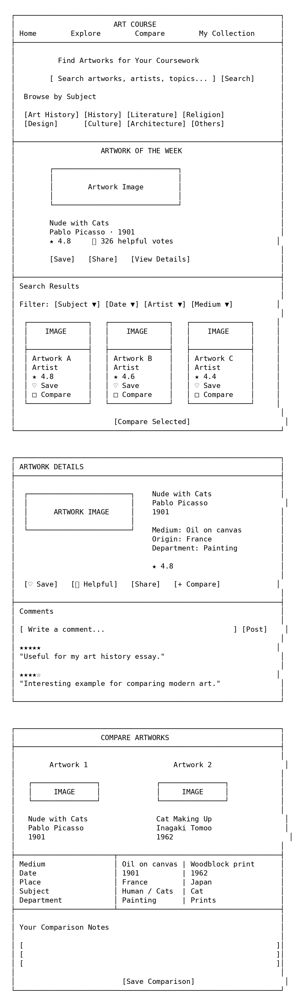
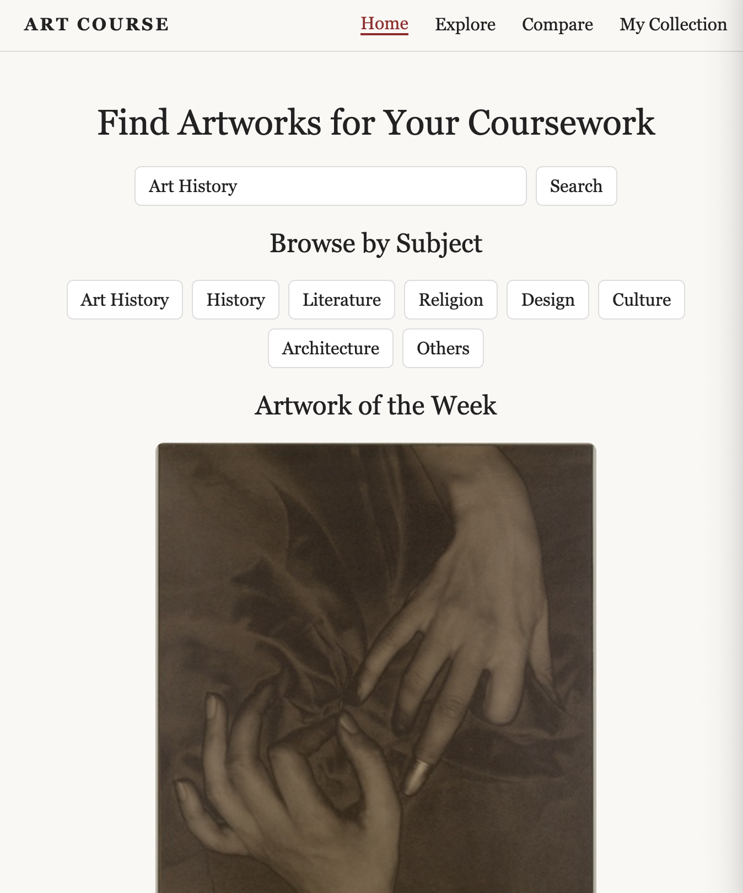
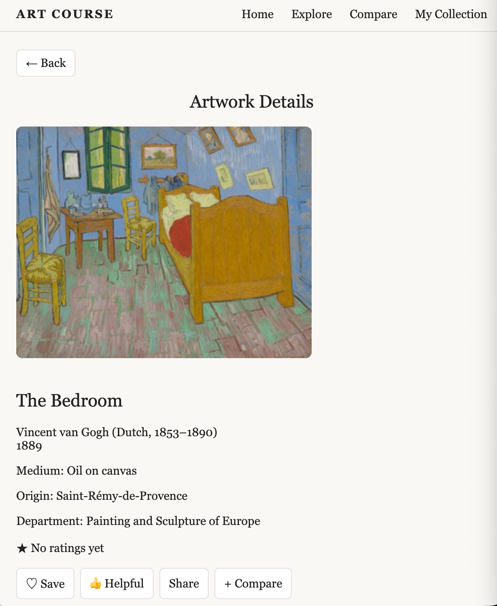
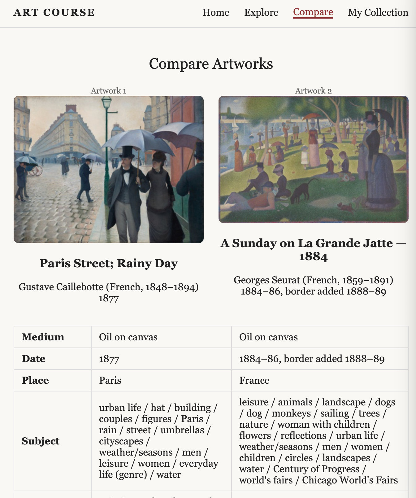

# Day 1 "before" snapshot

Write your own, even if you worked in a pair. Keep it: we come back to it at mid-quarter (Week 6) and at the end (Week 11). Your prompts go in `ai_log.md`, not here.

**Name:Murphy Jiang
**Partner (if any):Ryan Gao

## Before we prompted

### 1. Who is it for, and what do they want to do?

It's for university students who want to find related artworks to their coursework.

**"The user can..." sentences:**
1.Students can quickly search and filter real artworks from the Art Institute of Chicago based on their coursework
2.Students can compare multiple artworks, rate and comment on them, save and share  pieces, and discover the highest-rated artwork of the week.

### 2. Our sketch

Put the photo in this `hw0` folder, then change the filename below to match:

### 3. Our prediction

We expected the app would have a search bar, subject filters, and a grid of artwork results with images.

## What we got

### 4. What the AI made

Put the screenshot in this `hw0` folder, then change the filename below to match:

### 5. Sketch vs. app

- **Matches our sketch:The web page has a search bar, subject categories, and navigation for Explore, Compare, and My Collection. It also keeps the main title of helping students find artworks for coursework.
- **Different from our sketch:The final app has a cleaner and more formal layout than our sketch. There is no actual imagine pulled out so that some details couldn't show up.
- **The AI decided** (something we never said):The AI chose the font, color style, spacing, button shapes, navigation wording...

### 6. What did I keep, change, or reject, and why?
I would keep the format of everything because they are clean and direct, would be easy for student to operate. I would change the color style of the webpage since I want it to br more artistic and attractive to the target users. I would rejected the way of it showing "the art of the week". Instead, I want it to show that artwork as the background of the main page without noting it as a individual content section.

### 7. Explain back

Pick one part of the code. In your own words, what does it do?
async function search(text) {
  show("explore"); $("#results").innerHTML = "
Searching...
";
  try { last = await fetchArt(text); draw($("#results"), last); }
  catch { $("#results").innerHTML = "
Couldn't reach the Art Institute API.
"; }
}
$("#go").onclick = () => search($("#q").value);
$("#q").onkeydown = e => e.key === "Enter" && search($("#q").value);
$("#apply").onclick = () => search($("#q").value);
$("#cmpBtn").onclick = () => show("compare");
["Art History","History","Literature","Religion","Design","Culture","Architecture","Others"].forEach(s => {
  const b = document.createElement("button"); b.textContent = s;
  b.onclick = () => { $("#q").value = s === "Others" ? "" : s; search($("#q").value); };
  $("#subjects").append(b);
});
I would picked the search function. It takes what the user searches for, explores and gets matching artworks from the API, and shows them on the Explore page. If the API fails, it shows an error message.

## Looking ahead

### 8. What does it do? Does it work? What broke?
The app lets users search and browse artworks. Most of the page works, but the “Artwork of the Week” section did not show as i expected because I didn't explain to AI well.

### 9. How much do I understand about how it works? (0–100%)

**My number:**
20%
**Why that number:**
I don't really understand the meaning of each part of the code.

### 10. What would I need to know to tell whether it's *well designed or well built*?
I would need to know if users can understand the app easily, find what they need quickly, and use the features without confusion. I would also need to know if the code is organized, reliable, and handles errors well.

### 11. What do I hope to be able to do by week 10?

By week 10, I hope I can build a simple interactive web app by myself, understand  computer languages and feel comfortable to use them. I also want to use AI as a helper instead of fully depending on it.
