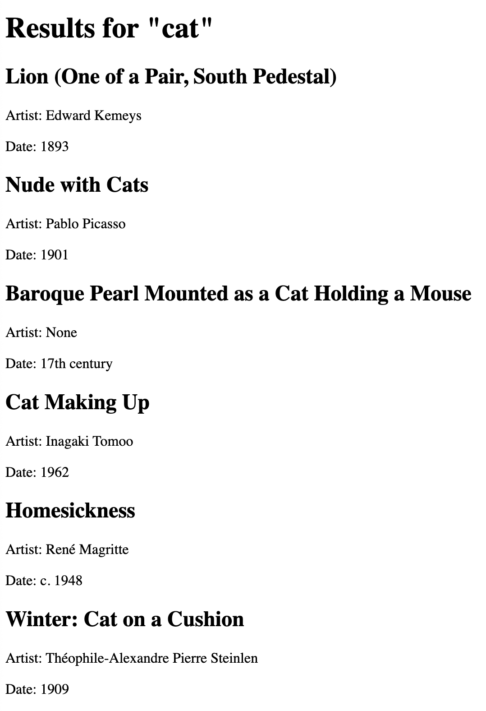

# Art Search Web App

This app is for College students who want to search for artworks based on key word from the Art Institute of Chicago collection.

## How to Run

1. Make sure Python, Flask, and requests are installed.
2. Open the project folder in VS Code.
3. Run: "python3 app.py"

4. Open the local address shown in the terminal, usually: http://127.0.0.1:5000

5. Enter a search term such as "cat" or "monet".

## Screenshot

