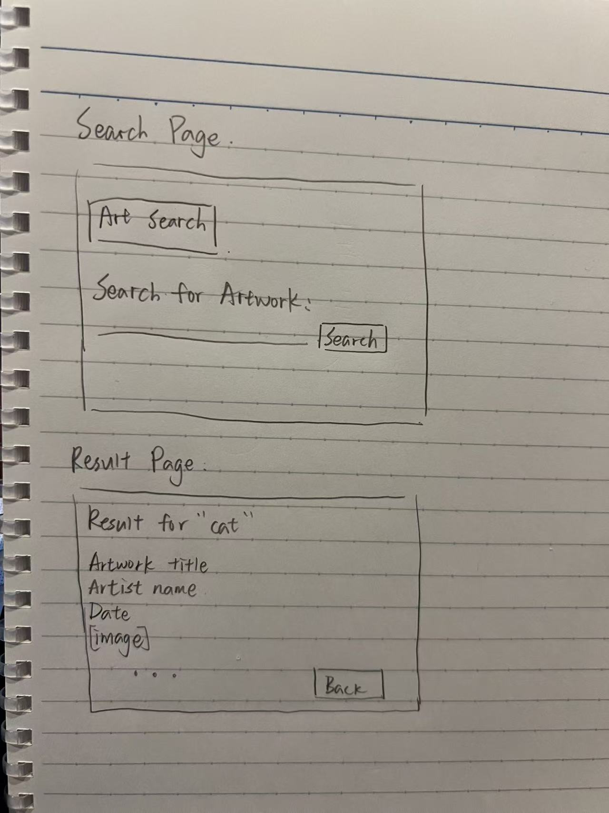

# Art Search Web App Plan

## 1. Screen Sketches

## 2. Data I Need

- title
- artist_title
- date_display
- image_id

## 3. Piece Specifications

### Piece 1: Home Route `/`

**Input:**  
The user opens the home page.

**Output:**  
The app shows the search page with a search form.

**Checks:**
1. Open `/` and make sure the search page appears.
2. Make sure the search box and Search button are visible.
3. Press Tab and make sure I can move from the input box to the Search button.

### Piece 2: Search Form

**Input:**  
The user types a search term into the form.

**Output:**  
The form sends the search term to `/results`.

**Checks:**
1. Search `cat` and make sure the browser goes to the results page.
2. Search `monet` and make sure the search term is received.
3. Submit an empty search and make sure the app shows a helpful message.

### Piece 3: `search_art(term)` in `api.py`

**Input:**  
A search term, such as `cat`.

**Output:**  
A list of artworks from the Art Institute API.

**Checks:**
1. Search `cat` and make sure artwork results are returned.
2. Search `monet` and make sure artwork results are returned.
3. Try a search with no results and make sure the app does not crash.

### Piece 4: Results Route `/results`

**Input:**  
The search term from the form.

**Output:**  
The app sends the artwork results to `results.html`.

**Checks:**
1. Search `cat` and make sure results appear.
2. Submit an empty search and see a helpful message.
3. If there is an API error, the app should show an error message instead of crashing.

### Piece 5: Results Page

**Input:**  
The artwork list from `app.py`.

**Output:**  
The page shows the artwork title, artist, date, and image.

**Checks:**
1. Make sure each artwork shows a title and artist.
2. Make sure a missing date or image does not crash the page.
3. Make sure there is a way to go back to the search page.