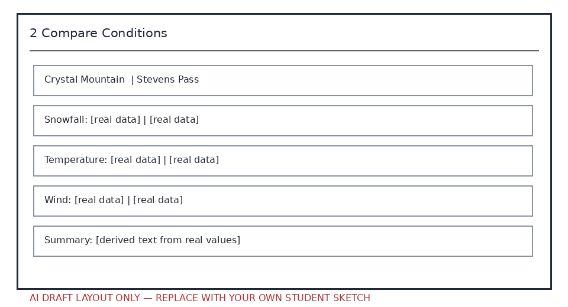

# P2 Proposal — Snow Compare

> Team: [TODO: team members]  
> Course: HCDE 310  
> Selected P1 concept: Snow Compare  
> Depth item: Many Lenses

## 1. Design problem, audience, and value (3–5 sentences)

Snow Compare is designed for skiers and snowboarders in Washington State who are deciding which resort to visit for an upcoming trip. They often check multiple websites to compare snowfall, wind, temperature, and basic resort information. Our app puts weather forecasts and resort characteristics on the same comparison page and generates a simple, transparent conditions summary. This helps users compare trade-offs quickly rather than switching between separate sources.

## 2. Depth item (2–3 sentences)

We chose **Many Lenses** because Snow Compare brings together forecast weather from Open-Meteo and resort information from OpenSkiData for the same ski areas. Our new design piece is a side-by-side comparison view with labeled weather figures, resort context, and a Python-generated conditions summary, so users can understand trade-offs instead of reading disconnected data. A success criterion for this depth item appears in Section 8.

## 3. Main user flow

### Action 1 — Select two ski resorts

| Step | The user... | The app... | They see... |
| --- | --- | --- | --- |
| 1 | opens the homepage | loads a list of available resorts | two labeled resort selectors |
| 2 | selects Crystal Mountain and Stevens Pass | checks that the choices are different | both chosen names and a Compare button |
| 3 | clicks Compare | validates the selections | a loading message or a helpful validation message |

**Mockup:**   
**State notes:** Empty: no comparison yet; Error: same resort chosen twice; Loading: "Getting forecasts..." after submission.

### Action 2 — Compare weather and resort details

| Step | The user... | The app... | They see... |
| --- | --- | --- | --- |
| 1 | opens comparison results | requests weather for both resort coordinates | a loading state while results are fetched |
| 2 | reads side-by-side data | combines weather metrics with resort records | snowfall, temperature, wind, and resort context |
| 3 | reads the conditions summary | identifies differences using Python rules | a plain-language comparison, with the original numbers |

**Mockup:**   
**State notes:** Empty: no valid result for selected day; Error: API unavailable or missing values; Loading: "Loading resort weather...".

### Action 3 — Save favorite resorts

| Step | The user... | The app... | They see... |
| --- | --- | --- | --- |
| 1 | clicks Save Favorites after comparing | validates resort IDs | a success or error status |
| 2 | returns to the homepage | reads favorite IDs from `data/favorites.json` | previously saved choices preselected |
| 3 | changes and saves the favorites | overwrites the stored IDs | the updated favorites on the next visit |

**Mockup:**   
**State notes:** Empty: no saved favorites yet; Error: failed JSON write; Loading: short saving indicator (if added using JavaScript).

**IMPORTANT:** Replace the included wireframe drafts with **your own original hand-drawn sketches** before submitting. Use actual data values in the final mockups, not placeholders. AI-refined wireframes cannot replace student sketches.

## 4. Data sources (at least two)

### Source A — Open-Meteo Forecast API

- **Docs:** https://open-meteo.com/en/docs
- **Used for:** Action 2, to fetch snowfall, maximum temperature, and maximum wind speed for each resort.
- **Keys/limits:** Usually no API key for noncommercial use; check current terms and rate limits in the documentation. API calls may fail or return missing values.
- **Call with real parameters (example):**
  `https://api.open-meteo.com/v1/forecast?latitude=46.93&longitude=-121.50&daily=snowfall_sum,temperature_2m_max,wind_speed_10m_max&timezone=America%2FLos_Angeles&forecast_days=3`
- **One real response:** **TODO — run the request yourself and paste a trimmed actual JSON response (include date, snowfall_sum, temperature_2m_max, wind_speed_10m_max).** Use `python collect_evidence.py` after installing requirements.
- **What we noticed:** **TODO — note a genuine observation after the call**, such as null values, units, or how daily fields align by index.

### Source B — OpenSkiData

- **Docs / project:** https://www.openskidata.org/
- **Used for:** Actions 1–2, to supply normalized resort names, locations, and available terrain/lift context for the resorts.
- **Keys/limits:** Public downloadable dataset; verify the exact download format, license, and fields for the chosen export. This is **not** a real-time snow report API.
- **Call or data import:** **TODO — identify and download the actual OpenSkiData file, then write the extraction/import step.** Current starter file `data/resorts.json` contains **provisional demo records**, not a verified OpenSkiData response.
- **One real response:** **TODO — paste a trimmed actual resort record** from downloaded OpenSkiData data, with the fields your app uses.
- **What we noticed:** **TODO — report an actual finding** about name matching, missing terrain fields, duplicate resorts, or coordinate formats.

**Data integration rule:** Match each resort's normalized record/coordinates to its Open-Meteo forecast. The end result is more than two source links: users see a side-by-side comparison and a Python-generated summary of the differences. **Validate coordinates/elevations and source attribution before final submission.**

## 5. Data model

| Noun | What it holds | Saved? Why? |
| --- | --- | --- |
| Resort | `id`, `name`, `latitude`, `longitude`, `source`, optional `elevation_m` and `terrain` | Yes, in `data/resorts.json`, to supply the selectable resort catalogue; replace demo entries with verified sourced data |
| Forecast | `date`, `snowfall_cm`, `temperature_c`, `wind_kmh`, `resort_id` | No, fetched fresh for comparisons |
| Favorites | `resort_ids` (two resort IDs) | Yes, in `data/favorites.json`, so the app remembers choices between visits |
| Comparison | two Resort records, two Forecast records, `summary` | No, computed when needed |

**Relationships:** One resort can have many daily forecasts. One comparison combines two resorts and their forecasts for a chosen date. Favorites references resort IDs.

## 6. Tech plan

| Route | Receives | Calls / reads | Shows |
| --- | --- | --- | --- |
| `GET /` | none | reads resort catalogue and saved favorites | labeled selectors and any saved choices |
| `POST /compare` | `resort_a`, `resort_b` | `weather.py` requests Open-Meteo; `resorts.py` reads catalogue | comparison table, summary or error message |
| `POST /favorites` | `resort_a`, `resort_b` | saves `data/favorites.json` | returns to homepage with feedback |

| File | What it does |
| --- | --- |
| `app.py` | Flask routes and input validation |
| `weather.py` | fetches and validates Open-Meteo weather data |
| `resorts.py` | reads and looks up resort catalogue |
| `summary.py` | builds a neutral text comparison from numeric values |
| `templates/index.html` | resort selector form |
| `templates/compare.html` | comparison table and Save Favorites form |
| `static/style.css` | basic styling and responsive layout |
| `data/resorts.json` | **provisional sample** resort records for development; replace with OpenSkiData-derived records |
| `data/favorites.json` | saved choices for the local demo |
| `collect_evidence.py` | prints a real weather API response for Section 4 |

**Demo setup:** Flask runs locally on a student's laptop; no always-on process is required for Many Lenses.

## 7. Who we will test with

| Role (not name) | How we will reach them | Planned date |
| --- | --- | --- |
| UW student who skis regularly | invite through an outdoor/ski group | [TODO: date] |
| UW student who snowboards occasionally | ask a friend who actually skis/rides | [TODO: date] |
| Washington beginner skier/snowboarder | reach out to a beginner in our network | [TODO: date] |

All three should try the app themselves, ideally without our help at the keyboard. **Confirm participants and dates with your group.**

## 8. Success criteria

**Code:**
1. Comparing two distinct resort IDs loads both records and, if the forecast service responds, shows snowfall, temperature, and wind values with clear units.
2. **Many Lenses:** the comparison view shows weather metrics and verified resort metadata together, and the Python summary correctly identifies which resort has more forecast snowfall and which has lower forecast wind when both values are present.
3. Saving valid favorites writes `data/favorites.json`; reopening the homepage preselects those favorites. Invalid inputs and API failures produce helpful messages rather than crashes.

**People:**
1. At least 2 of 3 participants can choose and compare two resorts within 3 minutes without help.
2. At least 2 of 3 participants correctly identify which resort has more forecast snowfall and lower wind based on the displayed data.
3. At least 2 of 3 participants can save and retrieve their selected resorts without guidance.

## 9. Priorities and risks

**Must-have:** two resort selectors; verified outside source #2; live forecast requests with failure handling; side-by-side display; conditions summary; favorites saved as JSON; labeled and keyboard-usable form; README and setup instructions.

**Nice-to-have (highest first):** select forecast day; weather charts; resort map; more resorts; personalized ranking. Cut from the bottom if behind.

**Risks:**
1. OpenSkiData download/import may be difficult or some fields may be absent. **Test early:** obtain one real record for each sample resort and verify keys/coordinates before expanding the interface.
2. Forecast request may fail or contain null values. **Test early:** run real requests and simulate network exceptions/empty daily values, checking that a clear message appears.

## 10. AI plan

We will ask AI to help explain Flask route patterns, suggest test cases, and review error handling for API requests. We will write and validate our own design decisions, user flows, source comparisons, and user research findings. We will check any AI-generated code by running the app and testing it against the code success criteria in Section 8. We will not hand off user testing or the final interpretation of participants' feedback, because those depend on our direct observations of real users.

## 11. Pairs / responsibilities

| Teammate | Owns | Notes |
| --- | --- | --- |
| [TODO: Member A] | `app.py`, `weather.py`, `summary.py` | coordinate API and Python logic |
| [TODO: Member B] | `templates/`, `static/`, mockups, testing | coordinate UI and accessibility |
| [TODO: shared] | `resorts.py`, data import, `p2.md`, README, integration checks | review together, avoid simultaneous edits |

## Accessibility checks (demonstrate at least three)

1. Inputs have visible `<label>` elements and help/error text.
2. Compare and save actions are keyboard-operable with visible focus indicators.
3. Data tables use headings (`<th scope=...>`) and units, with comparison statements also written in text (not conveyed by color alone).

## Before submitting

- [ ] Replace mockup drafts with your own sketches using actual fetched values.
- [ ] Paste **real**, trimmed responses for **both** data sources, plus genuine findings.
- [ ] Replace provisional resort catalogue with verified OpenSkiData-derived data.
- [ ] Confirm names/ownership and real user-testing dates.
- [ ] Confirm `.github/copilot-instructions.md` follows your class Stage 4 template.
- [ ] Check `.env` is untracked (`git status`) and never commit API keys.
- [ ] Push to GitHub, then one partner submits the commit link on Canvas.
