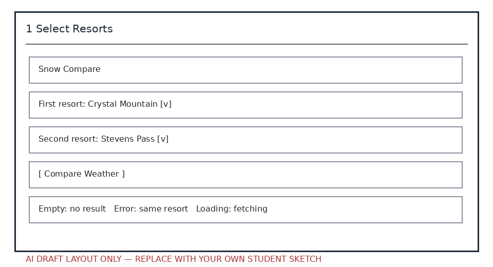
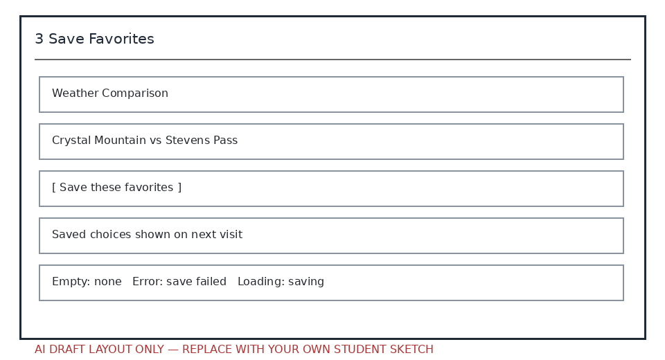

# P2 Proposal — Snow Compare

**Course:** HCDE 310  
**Team:** [TODO: Member A name], [TODO: Member B name]  
**Selected concept:** Snow Compare  
**Depth item:** Many Lenses  
**Data sources:** Open-Meteo + USDA NRCS SNOTEL (AWDB)

> **Team workflow:** Member A owns UX/people sections and three original mockups. Member B owns technical/data sections and real API evidence. Both review this final document. Bracketed TODOs require team confirmation; no sample outputs should be represented as measured data.

## 1. Design problem, audience and value (3–5 sentences) — Member A

Snow Compare is designed for skiers and snowboarders in Washington State who are planning their next ski trip and deciding between resorts. These users want to compare expected snowfall and wind with the snow already on the ground, but forecast and observed snowpack information may live on different websites. Our app combines forecasts from Open-Meteo with observations from a nearby SNOTEL station, clearly labeling the source, elevation, and observation time of each measurement. A side-by-side comparison and plain-language summary help users understand trade-offs without switching between multiple tabs or mistaking nearby station data for official resort conditions.

## 2. Depth item (2–3 sentences) — Member A

We chose **Many Lenses** because our app shows two different views of the same resort-area conditions: future weather forecasts from Open-Meteo and measured snowpack at nearby SNOTEL stations from USDA NRCS. Our new design piece is a side-by-side comparison with separate **Forecast** and **Observed Snowpack** sections, plus a Python-generated summary explaining the differences and limits of the data. The depth-item success criterion is included in Section 8.

## 3. Main user flow — Member A

### Action 1 — Select resorts

| Step | The user... | The app... | They see... |
| --- | --- | --- | --- |
| 1 | opens Snow Compare | loads the supported resort list and saved choices | two labeled resort selectors |
| 2 | selects Crystal Mountain and Stevens Pass | stores selections for the current request and checks for duplicates | selected names and a Compare button |
| 3 | selects a forecast date and clicks Compare | validates inputs and begins fetching both data types | a loading message or clear correction prompt |

**Original hand-drawn mockup:** 

**State notes:** Empty: ask for two different resorts. Loading: show “Loading conditions...”. Error: same resort twice or resort list unavailable; show an understandable message.

### Action 2 — Compare forecasts and observed snowpack

| Step | The user... | The app... | They see... |
| --- | --- | --- | --- |
| 1 | opens the comparison | requests Open-Meteo forecasts and nearby SNOTEL observations | separate loading indicators for forecast and observations |
| 2 | reads both resort cards | aligns forecasts by selected date and labels station measurements by location, elevation and timestamp | predicted snowfall, temperature and wind, plus nearby measured snow depth if available |
| 3 | reads the conditions summary | compares available forecast numbers using simple Python rules, without declaring which mountain has better snow | plain-language trade-offs and warnings about missing or non-resort observations |

**Original hand-drawn mockup:** 

**State notes:** Empty: “No forecast for this date” or “No nearby SNOTEL observation available.” Loading: indicate each data source separately. Error: a service is unavailable; retain any other valid data and label the missing lens.

**Important data distinction:** SNOTEL stations are near resorts, not necessarily on-resort. Do not label station measurements as official resort snow depth or compare station values without showing relevant context.

### Action 3 — Save a comparison

| Step | The user... | The app... | They see... |
| --- | --- | --- | --- |
| 1 | clicks Save Comparison | validates and writes resort IDs to a local JSON file | “Comparison saved” confirmation or error |
| 2 | returns later | reads saved resorts from JSON | saved resort pair on the homepage |
| 3 | opens the saved pair | requests new live forecasts and latest available station observations | refreshed conditions, not stale copied weather values |

**Original hand-drawn mockup:** 

**State notes:** Empty: “No saved comparisons yet.” Loading: “Saving...” if needed. Error: “Could not save your comparison; please try again.”

> **Mockup TODO:** Replace all three missing PNG placeholders with your team's actual sketches. Include **real values** obtained by Member B in Section 4 (with dates and units); do not make up numerical values. If AI refines a sketch, also submit the original sketch.

## 4. Data sources — Member B

### Source 1: Open-Meteo Forecast API

- **Documentation:** https://open-meteo.com/en/docs
- **Action/step:** Action 2, steps 1–3; forecast snowfall, temperature, wind for each chosen resort coordinate on the selected day.
- **Key/limits:** Check official noncommercial terms, usage limits and variable availability; key requirements vary by API tier. Handle timeouts, HTTP errors and missing forecast values.
- **Example request to run and verify (example coordinate only; confirm resort coordinates before using):**
  `https://api.open-meteo.com/v1/forecast?latitude=46.93&longitude=-121.50&daily=snowfall_sum,temperature_2m_max,wind_speed_10m_max&timezone=America%2FLos_Angeles&forecast_days=3`
- **One real trimmed response:** [TODO: run the call and paste **actual** JSON for date, snowfall, temperature, wind and units; do not invent. Save raw/trimmed response in `P2/evidence/open_meteo.json` if helpful.]
- **What surprised us:** [TODO: observation made after the real call, e.g., units, missing data, day indexing.]

### Source 2: USDA NRCS SNOTEL via AWDB

- **Documentation/official links:** https://wcc.sc.egov.usda.gov/awdbRestApi/swagger-ui/index.html ; https://www.nrcs.usda.gov/programs-initiatives/sswsf-snow-survey-and-water-supply-forecasting-program
- **Action/step:** Action 2, steps 1–3; find and show suitable **nearby** SNOTEL stations, their measured snow depth (when provided), observation timestamp, location and elevation; snow-water equivalent (SWE) is optional.
- **Key/limits:** [TODO: confirm exact authentication, rate limits, available elements and station coverage in the official documentation.] Handle unavailable stations, stale data, missing elements, and incompatible timestamps.
- **Real endpoint/call with parameters:** [TODO: use the official documentation to choose the exact station-metadata and time-series endpoint(s), then paste an actual URL/function call with real parameters. Do not assume an endpoint.] 
- **One real trimmed response:** [TODO: run the request and paste only fields actually returned and used; save in `P2/evidence/snotel.json` if helpful.]
- **What surprised us:** [TODO: report a genuine result such as missing snow depth, elevation mismatch, or differing update times.]

**Integration rule:** For each supported resort, associate a **verified nearby** SNOTEL station with station ID, distance, station elevation, observation timestamp, and an explicit “nearby station — not resort report” label. Use an approved fixed mapping for the P3 prototype if automated nearby-station discovery adds too much scope. Do not assume representative coverage before testing stations for both example resorts.

## 5. Data model — Member B

| Noun | What it holds | Saved? Why? |
| --- | --- | --- |
| **Resort** | `id`, `name`, `lat`, `lon`, optional `elevation_m`, `station_id` | Yes, in `data/resorts.json` as a small verified local list/mapping; the resort list is our curated application configuration, **not a third claimed outside source** |
| **Forecast** | `resort_id`, `date`, `snowfall_cm`, `temperature_c`, `wind_kmh`, `retrieved_at` | No; fetched on each comparison |
| **SNOTEL Station** | `station_id`, `name`, `lat`, `lon`, `elevation_m`, `distance_km` | Linked to resorts in `data/resorts.json`; verified through station metadata |
| **Snow Observation** | `station_id`, `observed_at`, `snow_depth_cm` (if available), optional `swe_mm` | No; fetched fresh and marked with measurement time |
| **Saved Comparison** | `resort_a_id`, `resort_b_id` | Yes, in `data/saved_comparisons.json`, to remember users' chosen resorts |

**Relationships:** One resort maps to one selected nearby station for the MVP; one station has multiple observations over time; each resort has multiple forecast dates; a comparison contains two resorts and their corresponding forecast/nearby-station results. Saved comparisons hold IDs only; conditions are refreshed when reopened.

## 6. Tech plan — Member B

| Route | Receives | Calls/reads | Shows |
| --- | --- | --- | --- |
| `GET /` | nothing | reads `data/resorts.json` and saved comparisons | resort selectors, saved pair or empty state |
| `POST /compare` | `resort_a`, `resort_b`, `date` | Open-Meteo, AWDB via helpers; validated resort-to-station mapping | side-by-side forecasts and separately labeled SNOTEL observations, summary or partial-error message |
| `POST /save` | two resort IDs | writes `data/saved_comparisons.json` | success/error feedback |

| File | What it will do in P3 (planned, not required to implement for P2) |
| --- | --- |
| `app.py` | Flask routes, form validation, error responses |
| `weather.py` | Open-Meteo requests and field normalization |
| `snotel.py` | AWDB station metadata / observation requests and validation |
| `resorts.py` | verified resort list and selected nearby station mapping |
| `comparison.py` | rule-based comparison summary, missing-data handling |
| `storage.py` | JSON persistence |
| `templates/index.html` | resort selection and saved pairs |
| `templates/compare.html` | side-by-side comparison and disclosure of source/time/elevation |
| `static/style.css` | responsive, accessible styling |
| `data/resorts.json` | verified resort coordinates + nearby-station IDs |
| `data/saved_comparisons.json` | saved resort pairs |

**Demo:** Run Flask on a laptop. Many Lenses does not need a continuously running computer, polling, scheduled jobs, map, or bot.

## 7. Who we will test with — Member A

| Audience role (not name) | How we will reach them | Planned testing date |
| --- | --- | --- |
| UW student who frequently snowboards in Washington | personal network / student outdoor club | [TODO: agree on specific date] |
| Recreational skier who regularly compares Washington resorts | personal network | [TODO: agree on specific date] |
| Newer skier or snowboarder planning a weekend trip | personal network or local ski community | [TODO: agree on specific date] |

All three are target users, not recruited simply because they are HCDE classmates. Each will try the app themselves while the team observes without controlling the keyboard.

## 8. Success criteria — A: people / B: code

**Code (Member B):**
1. A valid two-resort comparison displays date-labeled Open-Meteo forecasts for both with clear snowfall, temperature and wind units; invalid selections and API failures return useful states rather than crashes.
2. **Many Lenses:** each resort's result visibly distinguishes its forecast from any measured SNOTEL value, including station identity, time, and elevation; if observation data is unavailable, it says so rather than implying a current on-mountain snow report.
3. Saving a valid resort pair writes `data/saved_comparisons.json`, and reopening the homepage restores that pair.

**People (Member A):**
1. At least 2 of 3 users can select and compare two resorts in 3 minutes without assistance.
2. At least 2 of 3 users can correctly explain the difference between **forecast snowfall** and **observed snow depth from a nearby station** after viewing the comparison screen.
3. At least 2 of 3 users can save and reopen a resort pair without assistance.

## 9. Priorities and risks — Member B, reviewed with A

**Must-have (ordered):** validated two-resort selection; one verified nearby station per resort or an honest missing-station state; Open-Meteo forecast; AWDB observation request with graceful missing-data handling; clear side-by-side Many Lenses display; JSON save/reload; three accessibility checks; runnable README and safe `.env` handling in P3.

**Nice-to-have (highest first):** select a different forecast day; visual chart; station-distance/elevation explanation; add more resorts; personalized weighting. Cut from bottom if behind.

**Risks and early tests:**
1. **Station coverage mismatch:** nearby SNOTEL stations may be too far away, at a different elevation, or lack snow depth. Early test: retrieve stations/measurements for Crystal and Stevens, record distance/elevation and choose an honest fallback design.
2. **Data mismatch or outage:** forecast dates may not align with observed timestamps, or a service may fail. Early test: inspect real API responses and simulate missing/stale values, verifying the UI labels periods correctly and does not invent values.

## 10. AI plan — Both

We will use AI to help organize the proposal, review our interaction tables, and suggest Python/Flask error-handling and test ideas. We will make the design decisions ourselves, execute both external data requests, check all claims against actual responses, and use our own sketches for the required mockups. We will validate AI suggestions against the criteria in Section 8 and test the final app with three real users. We will not delegate user testing or interpretation of participant feedback because those require our own direct observations and judgment.

## 11. Pairs — Both

| Member | Owner of proposal parts and files | How we avoid conflicts |
| --- | --- | --- |
| **Member A — Product & UX** [TODO name] | Sections 1–3, 7, People criteria in 8; `P2/drafts/member_a_ux.md`; original mockups in `P2/mockups/` | A drafts UX separately, integrates final `P2/p2.md` after receiving B's text |
| **Member B — Technical & Data** [TODO name] | Sections 4–6, Code criteria in 8, Section 9; `P2/drafts/member_b_tech.md`; `P2/evidence/`, `.github/copilot-instructions.md`, `.gitignore` | B drafts technology separately, reviews the combined proposal for technical accuracy |
| **Both** | Sections 10–11, `P2/ai_use.md`, final review, commit and Canvas submission | Do not edit `P2/p2.md` simultaneously |

## Accessibility checks (P3 implementation commitments)

1. Explicit visible labels and understandable error messages for both resort selectors and date input.
2. Fully keyboard-usable controls with visible focus states.
3. Table headings, measurement units, source/timestamp text, and comparisons not communicated by color alone.

## P2 submission checklist

- [ ] Confirm team member names and real user testing dates.
- [ ] Member B pastes **two genuine** API responses and observations; confirms station mapping.
- [ ] Member A supplies **three original** mockups with actual supported content and empty/loading/error notes.
- [ ] Update context file to match Class Stage 4 template.
- [ ] Both members update `P2/ai_use.md` with their actual use.
- [ ] Verify `.gitignore` covers `.venv/` and `.env`; `git status` does not list secrets.
- [ ] Push and submit one GitHub commit link.
